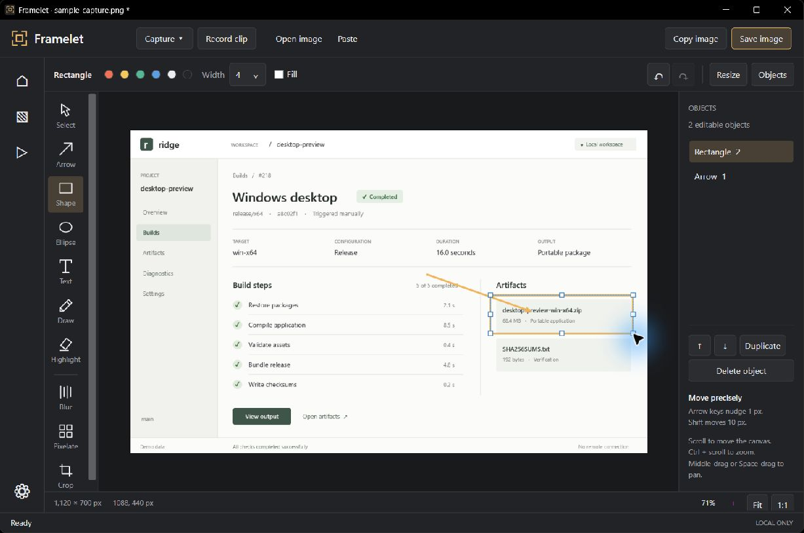

# Framelet

A focused Windows workspace for screenshots, image annotation, and short video clips. Local files, native recording, no accounts or uploads.



**Early preview:** Windows 11 22H2 or later, x64. [Download releases](https://github.com/Mxlted/framelet-windows/releases). Choose the per-user installer or extract the portable ZIP and run `Framelet.exe`. The .NET and native runtimes are included; FFmpeg is optional. Builds are currently unsigned. See [installation](docs/installation.md).

## What it does

- Region, window, monitor, and all-display screenshots, configurable global hotkeys, clipboard integration, automatic saving, and filename patterns.
- Image editor with crop, resize, arrows, rectangles, ellipses, text, pen, highlight, blur, pixelation, object selection/movement/resizing, layer order, and undo/redo. Open files, paste images, or edit a fresh capture.
- Native WGC recording with H.264/AAC MP4, system audio and microphone device selection, requested hardware encoding, cursor control, pause/resume, stop, cancel, and restart.
- Completed recordings survive a failed final save. The recording window shows the recovery path and offers **Save recording as…** without replacing existing files.
- Optional FFmpeg recording with codec choices and encoding parameters. **Settings → Recording → Use FFmpeg for recording** is off by default and switches the actual engine.
- Clip playback and trimming, exact re-encoding, keyframe-based lossless trimming, MP4 compression, and WebM conversion. Clip export uses FFmpeg independently of the recording checkbox.
- Neutral dark/light themes, system tray actions, and workflow-based settings.

Capture a region with **Ctrl+Shift+2**, active window with **Ctrl+Shift+3**, monitor under the pointer with **Ctrl+Shift+4**, or start/stop recording with **Ctrl+Shift+5**. All can be changed. In the editor, use **Ctrl+S** to save, **Ctrl+C** to copy, and **Ctrl+Z / Ctrl+Y** for undo/redo. [Editor gestures](docs/image-editor.md).

## Recording limits

60 FPS is the default target; actual capture rate depends on source/display/GPU. 120 FPS is experimental. Hardware encoding is a preference, not a guarantee. The FFmpeg backend has one DirectShow audio input and no pause; native recording provides independent system and microphone audio. SDR screenshots capture visible pixels; HDR, protected content, and secure desktops are not supported. Editable annotations are retained during the session, but saved images are flattened. See [current validation and limitations](docs/status.md).

## Development

Install the .NET 10 SDK and use PowerShell on Windows:

```powershell
./scripts/build.ps1
./scripts/test.ps1
./scripts/package.ps1
```

Packaging uses Inno Setup when installed and app-local VC++ runtime files from Visual Studio. It never downloads dependencies silently. Test scripts explain the opt-in interactive capture/audio tests.

For a diagnostic package in a fresh directory, pass `-OutputDirectory artifacts/package-check/<unique-name>` to `scripts/package.ps1`. This keeps the existing release artifacts untouched. [Audit fixes and validation](docs/audit-fixes.md).

The [UI/UX polish prompt](docs/prompts/ui-ux-polish.md) defines the next focused design and implementation pass, including live UI inspection, accessibility, DPI, and preservation of the audit fixes.

WPF owns the UI/editor. The native recording host wraps the MIT-licensed ScreenRecorderLib; FFmpeg recording and processing are separate components. This is an independent project, not a ShareX fork, and includes no ShareX source or assets. [Architecture and research](docs/architecture.md) · [Native pipeline](docs/native-recording.md) · [Third-party notices](THIRD_PARTY_NOTICES.md).

MIT licensed. See [LICENSE](LICENSE).
